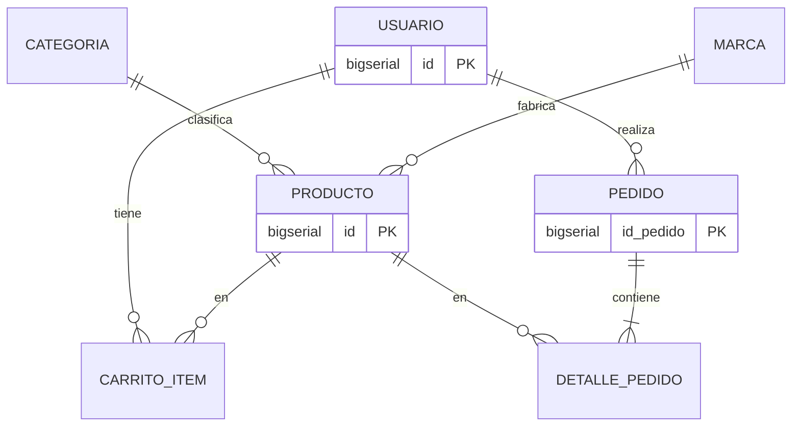

# Plan de Base de Datos – Yokai Hardware E-Commerce

> Alcance: SOLO plan. No se escribe ningún script completo hasta que lo apruebes. Hallazgos del repo: hoy solo existe el frontend React con mocks (`src/mocks/*`); **no hay carpeta de backend ni scripts SQL**.

## 1. Resumen ejecutivo
- PostgreSQL 15+, 3FN, 8 tablas: `usuario`, `categoria`, `marca`, `producto`, `carrito_item`, `pedido`, `detalle_pedido` (+ `reserva_stock` **fuera del MVP**).
- Esquema versionado con **Flyway** (SQL plano); Hibernate en `ddl-auto=validate` (test: Testcontainers + Flyway).
- Anti-overselling: **UPDATE condicional** (`WHERE stock >= :cant`) + `CHECK (stock >= 0)` como red de seguridad.
- Stock se descuenta al pasar a `PAGADO` (decisión resuelta); checkout crea el pedido en `PENDIENTE_PAGO` solo validando stock.
- `especificaciones` JSONB con claves `snake_case` normalizadas por categoría, índice GIN y CHECKs mínimos por categoría; atributos críticos de compatibilidad (`socket`, `tdp_w`, `watts`, `length_mm`…) quedan en JSONB con índices de expresión.
- Soft delete (`activo`) en `producto`; precios congelados en `detalle_pedido.precio_unit`.
- Dos roles de BD: `yokai_migrator` (DDL) y `yokai_app` (solo DML); SSL obligatorio; credenciales por env vars.
- Plan en 4 fases entre 20 y 28/oct (la ventana empezó el 19/oct), repartido entre los 10 integrantes.

## 2. Decisiones tomadas
| Decisión | Elegida | Descartada | Motivo |
|---|---|---|---|
| Estados de pedido | Ciclo lineal `PENDIENTE_PAGO→PAGADO→EN_PREPARACION→ENVIADO→ENTREGADO` + `CANCELADO` | `is_paid` booleano + estado logístico | Evita estados inconsistentes/carreras |
| Carrito | Híbrido: guest en LocalStorage, sync a `carrito_item` al autenticar (`/api/carrito/sync`) | Solo LocalStorage | Multidispositivo sin cargar la BD con anónimos |
| Especificaciones | JSONB + GIN | TEXT/VARCHAR; EAV | Validación a nivel motor, filtros en SQL |
| Reserva de stock | Fuera del MVP; descuento atómico en `PAGADO` | Reserva con TTL | Evita jobs/colas asíncronos |
| Borrado de producto | Soft delete `activo` + `@SQLRestriction` | DELETE CASCADE | Historia contable intacta |
| Auditoría | JPA Auditing (`@CreatedDate`, `@LastModifiedDate`) (+ Envers si hace falta) | Triggers | Lógica en el backend, testeable |
| Versionado | Flyway; `ddl-auto`: dev=validate, test=create-drop o validate, prod=validate | `ddl-auto=update` | Sin cambios silenciosos |
| Moneda ARS | `NUMERIC(12,2)` ↔ `BigDecimal` HALF_UP | float/double, centavos enteros | Precisión |
| Anti-overselling (recomendación mía) | UPDATE condicional | `FOR UPDATE`; `@Version` | Ver §2.1 |

### 2.1 Comparación anti-overselling
| Estrategia | Pros | Contras | Veredicto |
|---|---|---|---|
| Pesimista `SELECT … FOR UPDATE` | Simple de razonar | Locks largos, riesgo de deadlock, 2 roundtrips | Descartada |
| Optimista `@Version` | Sin locks | Reintentos bajo alta contención en productos populares (RTX con stock 3) | Descartada |
| **UPDATE condicional** | 1 sentencia atómica, sin locks largos, `rowsAffected=0` ⇒ sin stock | Requiere query nativa/`@Modifying` | **Elegida** |

```sql
UPDATE producto SET stock = stock - :cant, updated_at = now()
WHERE id = :id AND activo AND stock >= :cant;  -- 0 filas => "Sin stock", rollback
```
Para evitar deadlocks, el servicio procesa los ítems **ordenados por `producto_id`**.

> [!WARNING]
> **Tensión entre reglas**: el requisito 2 dice "checkout descuenta stock", pero la decisión 4 dice "descuento al confirmarse el pago". Plan: checkout = validar stock + crear `pedido` `PENDIENTE_PAGO` + vaciar carrito (sin descontar); `PENDIENTE_PAGO→PAGADO` = UPDATE condicional por ítem en la misma transacción. Consecuencia: si entre checkout y pago se agota, el pago falla/cancela. Se restituye stock al cancelar desde `PAGADO` o `EN_PREPARACION` (no desde `PENDIENTE_PAGO`, que nunca descontó). Ver Pregunta 1.

La validez de transiciones se aplica en el **servicio** (sin triggers, por decisión 6); la BD garantiza solo el dominio con `CHECK (estado IN (…))`.

## 3. Modelo de datos propuesto


### Diccionario de datos
| Tabla | Columna | Tipo | Restricciones |
|---|---|---|---|
| usuario | id | BIGSERIAL | PK |
| | nombre | VARCHAR(100) | NOT NULL |
| | email | VARCHAR(120) | NOT NULL, UNIQUE (índice sobre `lower(email)`) |
| | password | VARCHAR(255) | NOT NULL (BCrypt) |
| | rol | VARCHAR(20) | NOT NULL, CHECK IN ('CLIENTE','ADMIN'), DEFAULT 'CLIENTE' |
| | direccion | TEXT | NULL |
| | created_at | TIMESTAMP | NOT NULL DEFAULT now() |
| | updated_at | TIMESTAMP | NOT NULL (JPA Auditing) *supuesto* |
| categoria | id | BIGSERIAL | PK |
| | nombre | VARCHAR(50) | NOT NULL, UNIQUE |
| | descripcion | TEXT | |
| marca | id | BIGSERIAL | PK |
| | nombre | VARCHAR(100) | NOT NULL, UNIQUE *(largo supuesto)* |
| producto | id | BIGSERIAL | PK |
| | sku | VARCHAR(50) | NOT NULL, UNIQUE |
| | nombre | VARCHAR(150) | NOT NULL |
| | precio | NUMERIC(12,2) | NOT NULL, CHECK > 0 |
| | stock | INTEGER | NOT NULL DEFAULT 0, CHECK >= 0 |
| | stock_minimo | INTEGER | NOT NULL DEFAULT 0, CHECK >= 0 |
| | estado_stock | VARCHAR(20) | `GENERATED ALWAYS AS (CASE WHEN stock=0 THEN 'SIN_STOCK' WHEN stock<=stock_minimo THEN 'ULTIMAS_UNIDADES' ELSE 'EN_STOCK' END) STORED`; mapeado `insertable=false, updatable=false` |
| | categoria_id | BIGINT | NOT NULL FK → categoria |
| | marca_id | BIGINT | NOT NULL FK → marca |
| | especificaciones | JSONB | NOT NULL DEFAULT '{}', CHECK jsonb_typeof='object' |
| | activo | BOOLEAN | NOT NULL DEFAULT true |
| | created_at / updated_at | TIMESTAMP | NOT NULL |
| carrito_item | id | BIGSERIAL | PK |
| | usuario_id | BIGINT | NOT NULL FK → usuario ON DELETE CASCADE |
| | producto_id | BIGINT | NOT NULL FK → producto ON DELETE RESTRICT |
| | cantidad | INTEGER | NOT NULL, CHECK > 0 |
| | | | UNIQUE (usuario_id, producto_id) |
| pedido | id_pedido | BIGSERIAL | PK |
| | usuario_id | BIGINT | NOT NULL FK → usuario ON DELETE RESTRICT |
| | fecha | TIMESTAMP | NOT NULL DEFAULT now() |
| | estado | VARCHAR(30) | NOT NULL DEFAULT 'PENDIENTE_PAGO', CHECK IN (6 estados) |
| | total | NUMERIC(12,2) | NOT NULL, CHECK >= 0 |
| | direccion_envio | TEXT | NOT NULL |
| | updated_at | TIMESTAMP | NOT NULL *supuesto* |
| detalle_pedido | id_detalle | BIGSERIAL | PK |
| | pedido_id | BIGINT | NOT NULL FK → pedido(id_pedido) ON DELETE CASCADE |
| | producto_id | BIGINT | NOT NULL FK → producto ON DELETE RESTRICT |
| | cantidad | INTEGER | NOT NULL, CHECK > 0 |
| | precio_unit | NUMERIC(12,2) | NOT NULL, CHECK >= 0 (congelado) |
| | | | UNIQUE (pedido_id, producto_id) |

**Políticas FK**: `ON UPDATE NO ACTION` en todas (PKs surrogate inmutables). `ON DELETE RESTRICT` hacia `producto`, `usuario` (pedidos), `categoria`, `marca`; `CASCADE` solo carrito→usuario y detalle→pedido.
**Inmutabilidad de precios**: `precio_unit` se copia del `producto.precio` al crear el pedido; el `total` se calcula en el backend con `BigDecimal` y se valida con un test (`total = Σ cantidad·precio_unit`).

> [!NOTE]
> Los mocks del frontend usan campos que no están en el modelo del documento: `imagen`, `descripcion`, `destacado`, `etiquetaYokai`, `subtituloCorto` (producto) y `metodoPago` (pedido). Ver Pregunta 3.

## 4. Estructura del JSONB `especificaciones`
Claves `snake_case`, unidades en el nombre (`_mm`, `_w`, `_gb`, `_mhz`), valores numéricos como número. Los mocks usan claves en español con texto libre (p. ej. `"Dimensiones": "336 x 150 x 63 mm"`) que **no sirven para el motor**; el front deberá mapear clave→etiqueta visible.

| Categoría | Claves obligatorias (usadas por el motor en **negrita**) | Ejemplo |
|---|---|---|
| Oni (GPU) | **`tdp_w`**, **`length_mm`**, `vram_gb`, `memoria_tipo`, `power_connector`, `slots` | `{"tdp_w":285,"length_mm":336,"vram_gb":16,"memoria_tipo":"GDDR6X","power_connector":"12VHPWR","slots":3.15}` |
| Kitsune (CPU) | **`socket`**, **`tdp_w`**, `nucleos`, `hilos`, `base_ghz`, `boost_ghz`, `memoria_soportada` | `{"socket":"AM5","tdp_w":120,"nucleos":8,"hilos":16,"memoria_soportada":"DDR5"}` |
| Tengu (RAM) | `tipo` (DDR4/DDR5), `capacidad_gb`, `modulos`, `velocidad_mhz`, `latencia_cl` | `{"tipo":"DDR5","capacidad_gb":32,"modulos":2,"velocidad_mhz":6000}` |
| Placa madre | **`socket`**, `chipset`, `formato`, `memoria_tipo`, `slots_ram` | `{"socket":"AM5","chipset":"B650","formato":"ATX","memoria_tipo":"DDR5"}` |
| Fuente | **`watts`**, `certificacion`, `modular`, `formato` | `{"watts":850,"certificacion":"80+ Gold","modular":true}` |
| Gabinete | **`max_gpu_mm`**, **`max_cooler_mm`**, `formatos_placa[]`, `formato` | `{"max_gpu_mm":420,"max_cooler_mm":167,"formatos_placa":["ATX","mATX"]}` |
| Almacenamiento | `tipo` (NVMe/SATA), `capacidad_gb`, `lectura_mb_s`, `escritura_mb_s` | `{"tipo":"NVMe","capacidad_gb":2000,"lectura_mb_s":7000}` |

**Alturas de disipador**: `cpu_cooler`/disipador no es categoría del contexto; el motor puede comparar `max_cooler_mm` del gabinete solo si existen productos disipador (**supuesto**, ver Pregunta 4).

**¿Columnas para atributos críticos?** Decisión: **mantener en JSONB** (flexibilidad, cumple decisión 3) y aplicar:
1. `CHECK` por categoría (clave presente y numérica) mediante función `IMMUTABLE` `validar_specs(categoria_id, jsonb)` o CHECKs simples por `categoria_id` — evaluar costo/beneficio en Fase 2.
2. Índices de expresión: `((especificaciones->>'socket'))` y GIN `jsonb_path_ops` para filtros facetados.
Alternativa si el rendimiento no alcanza: columnas generadas `STORED` (`socket`, `tdp_w`). Se documenta como plan B, no se implementa.

## 5. Plan por fases (20–28/oct/2026)
Roles (10 integrantes): **ARQ** (arquitecto BD, 1), **DEV-SQL** (2–3), **BACK** (2), **QA** (2), **DEVOPS** (1), **DOC/PM** (1).

| Fase | Fechas | Tareas | Resp. | Dep. | Entregable | Aceptación |
|---|---|---|---|---|---|---|
| F0 Aprobación y setup | 20–21/oct | 1. Aprobar plan y resolver preguntas. 2. Crear proyecto Supabase/Neon, roles y SSL. 3. Definir repo/ramas | ARQ, DEVOPS, PM | — | Instancia dev + `docs/db/decisiones.md` | Conexión SSL desde local con `yokai_app`; preguntas cerradas |
| F1 Schema | 21–23/oct | 4. V1 usuario. 5. V2 catálogo (categoria, marca, producto). 6. V3 carrito. 7. V4 pedidos | DEV-SQL (1 PR por migración, autores distintos) | F0 | `V1…V4` | `flyway migrate` limpio en Postgres 15; `ddl-auto=validate` OK |
| F2 Reglas e índices | 23–25/oct | 8. CHECK/FK finos. 9. V5 índices. 10. Estructura JSONB + validación. 11. Seed referencia (categorías, marcas) | ARQ, DEV-SQL | F1 | `V5`, `V6`, doc JSONB | `EXPLAIN` usa los índices en consultas críticas |
| F3 Seed y pruebas | 25–27/oct | 12. Seed demo (~30 productos migrados de mocks, usuarios, pedidos). 13. Tests integridad/concurrencia (Testcontainers). 14. Roles y permisos. 15. Verificar con BACK entidades JPA | DEV-SQL, QA, BACK, DEVOPS | F2 | `seed/`, tests verdes, `V7` permisos | 50 hilos sobre stock=3 ⇒ exactamente 3 ventas; app conecta con rol mínimo |
| F4 Cierre | 27–28/oct | 16. Deploy BD pública, runbook, README. 17. Revisión cruzada y trazabilidad Git | DEVOPS, PM, ARQ | F3 | `docs/db/README.md` | BD pública accesible por backend de staging; ≥1 PR por integrante en el log |

## 6. Estrategia de índices y consultas críticas
**Consultas**: (1) catálogo facetado: categoría + marca + rango de precio + estado de stock, orden por precio/nombre, paginado; (2) detalle por id/sku; (3) búsqueda por nombre; (4) carrito por usuario; (5) historial de pedidos por usuario ordenado por fecha; (6) admin: productos con stock bajo; (7) admin: pedidos por estado + fecha; (8) filtro por spec (socket/tipo RAM).

| Índice | Sirve a |
|---|---|
| `producto(categoria_id, marca_id, precio) WHERE activo` | 1 |
| `producto(precio, id) WHERE activo` | 1 (keyset pagination) |
| `producto(stock) WHERE activo AND stock <= stock_minimo` (parcial) | 6 |
| GIN `producto USING (especificaciones jsonb_path_ops)` + índice expresión `socket` | 8 |
| GIN trigram `producto(nombre)` (`pg_trgm`, disponible en Supabase/Neon) *opcional* | 3 |
| `pedido(usuario_id, fecha DESC)` | 5 |
| `pedido(estado, fecha DESC)` | 7 |
| `detalle_pedido(pedido_id)`, `(producto_id)` (FK) | joins/borrado |
| `carrito_item` UNIQUE (usuario_id, producto_id) | 4 |
| UNIQUE `lower(email)` | login |

Paginación: preferir **keyset** para catálogo; `OFFSET` aceptable en admin. Revisar con `EXPLAIN (ANALYZE, BUFFERS)` sobre seed ampliado.

## 7. Estrategia de pruebas
- **Infra**: Testcontainers `postgres:15-alpine`, Flyway aplica todas las migraciones, `ddl-auto=validate` (verifica que las entidades coincidan con el esquema).
- **Integridad**: violación de UNIQUE (email, sku, carrito), CHECK (stock negativo, cantidad ≤ 0, estado inválido, rol inválido), FK RESTRICT (borrar producto con pedidos), JSONB no objeto rechazado, `estado_stock` en los 3 umbrales, soft delete oculto en repositorio.
- **Concurrencia**: N hilos (p. ej. 50) comprando producto con stock=3 vía servicio de pago ⇒ stock final 0, exactamente 3 éxitos, nunca negativo; ítems cruzados en orden inverso (A,B vs B,A) sin deadlock; rollback total si falla el 2º ítem (stock del 1º intacto, carrito sin vaciar).
- **Máquina de estados**: transiciones válidas/ inválidas; cancelación restituye stock solo desde `PAGADO`/`EN_PREPARACION`.
- **Precios**: cambiar `producto.precio` después de pedir no altera `detalle_pedido.precio_unit` ni `total`.
- **Seed**: se carga sobre esquema vacío sin errores; idempotencia verificada.
- **Rendimiento (smoke)**: seed ampliado a ~5.000 productos; consultas críticas con índice (sin Seq Scan).

## 8. Estructura del repositorio
```
db/                         (supuesto: ubicación; ver Pregunta 5)
├── migration/              V1__crear_usuario.sql … V7__permisos_app.sql
├── seed/                   R__seed_referencia.sql (categorías, marcas)
│                           dev/R__seed_demo.sql (solo perfil dev/demo)
├── ops/                    crear_roles.sql (manual, sin contraseñas)
└── README.md
docs/db/                    modelo.md (DER), jsonb_especificaciones.md, decisiones.md
```
- Convención Flyway: `V<n>__<descripcion_snake>.sql`; las migraciones aplicadas **no se editan**: se crea una nueva.
- Ramas: `feature/db-<tema>`, `fix/db-<tema>`; PR a `develop`; mínimo 1 reviewer distinto del autor; commits convencionales (`feat(db): …`). `main` solo por PR desde `develop`.
- `flyway.locations`: dev = `migration,seed/dev`; prod = `migration,seed` (sin demo).
- Secretos: `DB_URL`, `DB_USER`, `DB_PASSWORD` por env; `.env` ya existe en el repo → verificar que esté en `.gitignore` y mantener `.env.example` sin valores reales.

## 9. Riesgos y mitigaciones
| Riesgo | Mitigación |
|---|---|
| Pooler de Supabase/Neon (transaction mode) rompe Flyway/advisory locks | Flyway usa conexión **directa**; la app usa el pooler |
| Contradicción stock checkout vs `PAGADO` | Resolver Pregunta 1 antes de F1 |
| Claves JSONB heterogéneas de los mocks | Doc de claves + validación en seed y CHECK; mapeo de etiquetas en front |
| Deadlocks por orden de ítems | Procesar por `producto_id` ascendente + test |
| Cambio de esquema tras migración aplicada | Regla "nunca editar V aplicadas"; `flyway validate` en CI |
| Ventana corta (ya empezada) y trabajo repartido | PRs pequeños por migración; ARQ revisa todo; fases solapadas |
| Plan gratuito de Supabase/Neon (pausa, límites) | Backup `pg_dump` en F4; mantener instancia viva antes de la entrega |
| Contraseña admin seed expuesta | Hash BCrypt por variable de entorno/placeholder; nunca en claro en el repo |
| Transiciones inválidas por estar solo en servicio | Tests de transición + único punto de cambio de estado (`PedidoService`) |

## 10. Contrato de ejecución (archivos a generar)
1. `db/migration/V1__crear_usuario.sql` – tabla usuario, CHECK de rol, índice `lower(email)`.
2. `db/migration/V2__crear_catalogo.sql` – categoria, marca, producto (con `estado_stock` generado, `activo`, JSONB).
3. `db/migration/V3__crear_carrito.sql` – carrito_item + UNIQUE.
4. `db/migration/V4__crear_pedidos.sql` – pedido, detalle_pedido, CHECK de estados.
5. `db/migration/V5__indices.sql` – índices de §6.
6. `db/migration/V6__validacion_especificaciones.sql` – CHECKs/función de validación JSONB.
7. `db/migration/V7__permisos_app.sql` – GRANTs mínimos a `yokai_app`.
8. `db/seed/R__seed_referencia.sql` – categorías y marcas.
9. `db/seed/dev/R__seed_demo.sql` – productos (desde mocks), usuarios, pedidos de ejemplo.
10. `db/ops/crear_roles.sql` – roles `yokai_migrator`/`yokai_app` (sin contraseñas).
11. `docs/db/modelo.md` – DER Mermaid + diccionario final.
12. `docs/db/jsonb_especificaciones.md` – contrato de claves por categoría.
13. `docs/db/decisiones.md` – tabla de decisiones.
14. `db/README.md` – ejecución, variables de entorno, runbook de deploy.
15. Tests (si el backend existe): `SchemaIntegrityIT`, `CheckoutConcurrencyIT`, `PedidoEstadoIT`, `PrecioInmutableIT` con base `AbstractPostgresIT` (Testcontainers).
16. `application-{dev,test,prod}.yml` (solo bloques `datasource`/`flyway`/`jpa.ddl-auto`; si el backend existe).

## Preguntas abiertas
> [!IMPORTANT]
> **1. Momento del descuento de stock**: ¿aceptás mi interpretación (checkout valida; descuento al pasar a `PAGADO`)? Alternativa: descontar en checkout y restituir al cancelar/expirar (más simple, pero contradice la decisión 4).

2. **Auditoría** (supuesto): agrego `updated_at` en usuario/producto/pedido y no `created_by` ni tabla de historial de estados (Envers a pedido). ¿OK?
3. **Campos de mocks** (`imagen`, `descripcion`, `destacado`, `metodo_pago`): no están en el modelo. Propongo agregar `imagen_url TEXT`, `descripcion TEXT`, `destacado BOOLEAN` a producto y `metodo_pago VARCHAR(50)` a pedido. ¿Los incluyo?
4. **Categorías de compatibilidad**: el contexto menciona "altura de disipador" pero no hay categoría de disipadores. ¿La agrego o se valida solo GPU/gabinete?
5. **Ubicación del backend**: no existe carpeta backend en este repo. ¿Los scripts van en `db/` en la raíz de este repo, o en el repo/carpeta del backend (`src/main/resources/db/migration`)?
6. **Proveedor**: ¿Supabase o Neon (cambia detalles de roles/pooler)?
7. **Nombres de PK**: el documento mezcla `id` e `id_pedido`/`id_detalle`; mantengo tal cual por fidelidad al documento. ¿OK?
