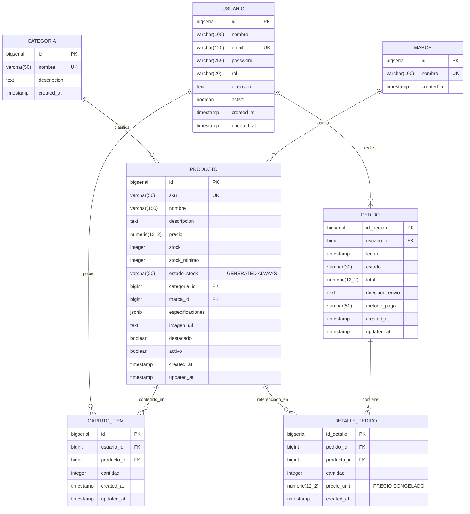

# Diagrama Entidad-Relación y Diccionario de Datos

Proyecto: **Yokai Hardware E-Commerce** (UTN San Rafael - Programación IV)  
Motor: PostgreSQL 15+  
Normalización: 3FN  

---

## Diccionario de Datos

### Tabla: `usuario`
| Columna | Tipo de Dato | Nulo | Default | Restricciones / Comentarios |
|---|---|---|---|---|
| `id` | `BIGSERIAL` | NO | autoincrement | Primary Key |
| `nombre` | `VARCHAR(100)` | NO | - | Nombre completo del usuario |
| `email` | `VARCHAR(120)` | NO | - | Unique Index en `lower(email)` |
| `password` | `VARCHAR(255)` | NO | - | Hash BCrypt ($2a$, $2b$) |
| `rol` | `VARCHAR(20)` | NO | `'CLIENTE'` | `CHECK (rol IN ('CLIENTE', 'ADMIN'))` |
| `direccion` | `TEXT` | SÍ | `NULL` | Domicilio predeterminado |
| `activo` | `BOOLEAN` | NO | `true` | Soft delete y bloqueo de cuenta |
| `created_at` | `TIMESTAMP` | NO | `CURRENT_TIMESTAMP` | Auditoría de creación |
| `updated_at` | `TIMESTAMP` | NO | `CURRENT_TIMESTAMP` | Trigger automático |

### Tabla: `producto`
| Columna | Tipo de Dato | Nulo | Default | Restricciones / Comentarios |
|---|---|---|---|---|
| `id` | `BIGSERIAL` | NO | autoincrement | Primary Key |
| `sku` | `VARCHAR(50)` | NO | - | Unique Constraint |
| `nombre` | `VARCHAR(150)` | NO | - | Denominación comercial |
| `descripcion` | `TEXT` | SÍ | `NULL` | Detalle extenso del producto |
| `precio` | `NUMERIC(12,2)` | NO | - | `CHECK (precio > 0)` |
| `stock` | `INTEGER` | NO | `0` | `CHECK (stock >= 0)` |
| `stock_minimo` | `INTEGER` | NO | `0` | `CHECK (stock_minimo >= 0)` |
| `estado_stock`| `VARCHAR(20)` | NO | *GENERATED* | `STORED` (SIN_STOCK, ULTIMAS_UNIDADES, EN_STOCK) |
| `categoria_id`| `BIGINT` | NO | - | `FK -> categoria(id) ON DELETE RESTRICT` |
| `marca_id` | `BIGINT` | NO | - | `FK -> marca(id) ON DELETE RESTRICT` |
| `especificaciones`| `JSONB` | NO | `'{}'` | Atributos para compatibilidad y filtros |
| `imagen_url` | `TEXT` | SÍ | `NULL` | URL de la imagen principal |
| `destacado` | `BOOLEAN` | NO | `false` | Visualización destacada en Home |
| `activo` | `BOOLEAN` | NO | `true` | Soft Delete (`@SQLRestriction`) |
| `created_at` | `TIMESTAMP` | NO | `CURRENT_TIMESTAMP` | Auditoría |
| `updated_at` | `TIMESTAMP` | NO | `CURRENT_TIMESTAMP` | Trigger automático |

### Tabla: `carrito_item`
| Columna | Tipo de Dato | Nulo | Default | Restricciones / Comentarios |
|---|---|---|---|---|
| `id` | `BIGSERIAL` | NO | autoincrement | Primary Key |
| `usuario_id` | `BIGINT` | NO | - | `FK -> usuario(id) ON DELETE CASCADE` |
| `producto_id`| `BIGINT` | NO | - | `FK -> producto(id) ON DELETE RESTRICT` |
| `cantidad` | `INTEGER` | NO | - | `CHECK (cantidad > 0)` |
| `created_at` | `TIMESTAMP` | NO | `CURRENT_TIMESTAMP` | Auditoría |
| `updated_at` | `TIMESTAMP` | NO | `CURRENT_TIMESTAMP` | Trigger automático |
*Restricción compuesta:* `UNIQUE (usuario_id, producto_id)`.

### Tabla: `pedido`
| Columna | Tipo de Dato | Nulo | Default | Restricciones / Comentarios |
|---|---|---|---|---|
| `id_pedido` | `BIGSERIAL` | NO | autoincrement | Primary Key |
| `usuario_id` | `BIGINT` | NO | - | `FK -> usuario(id) ON DELETE RESTRICT` |
| `fecha` | `TIMESTAMP` | NO | `CURRENT_TIMESTAMP` | Fecha de creación de orden |
| `estado` | `VARCHAR(30)` | NO | `'PENDIENTE_PAGO'` | `CHECK (estado IN ('PENDIENTE_PAGO','PAGADO','EN_PREPARACION','ENVIADO','ENTREGADO','CANCELADO'))` |
| `total` | `NUMERIC(12,2)` | NO | - | `CHECK (total >= 0)` |
| `direccion_envio` | `TEXT` | NO | - | Destino del pedido |
| `metodo_pago` | `VARCHAR(50)` | SÍ | `NULL` | Transferencia, Mercado Pago, etc. |
| `created_at` | `TIMESTAMP` | NO | `CURRENT_TIMESTAMP` | Auditoría |
| `updated_at` | `TIMESTAMP` | NO | `CURRENT_TIMESTAMP` | Trigger automático |

### Tabla: `detalle_pedido`
| Columna | Tipo de Dato | Nulo | Default | Restricciones / Comentarios |
|---|---|---|---|---|
| `id_detalle` | `BIGSERIAL` | NO | autoincrement | Primary Key |
| `pedido_id` | `BIGINT` | NO | - | `FK -> pedido(id_pedido) ON DELETE CASCADE` |
| `producto_id`| `BIGINT` | NO | - | `FK -> producto(id) ON DELETE RESTRICT` |
| `cantidad` | `INTEGER` | NO | - | `CHECK (cantidad > 0)` |
| `precio_unit`| `NUMERIC(12,2)` | NO | - | `CHECK (precio_unit >= 0)`. **Inmutable**. |
| `created_at` | `TIMESTAMP` | NO | `CURRENT_TIMESTAMP` | Auditoría |
*Restricción compuesta:* `UNIQUE (pedido_id, producto_id)`.
